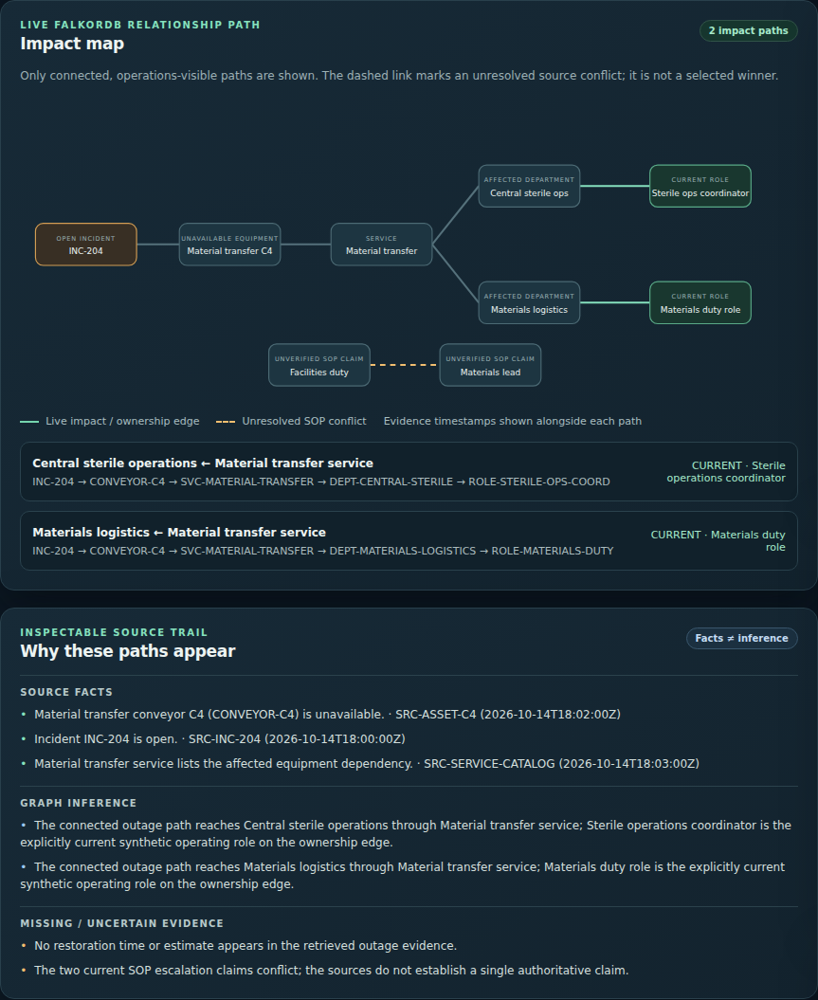
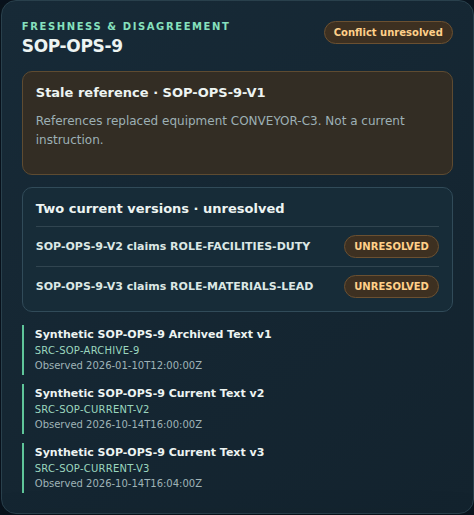
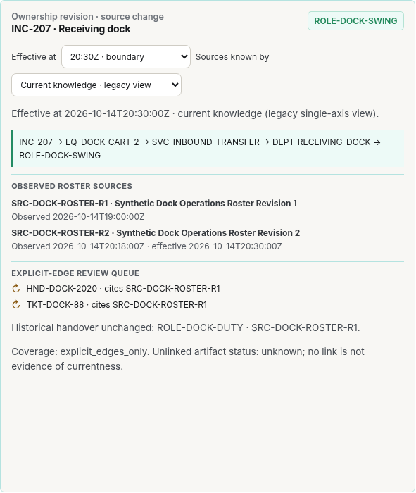
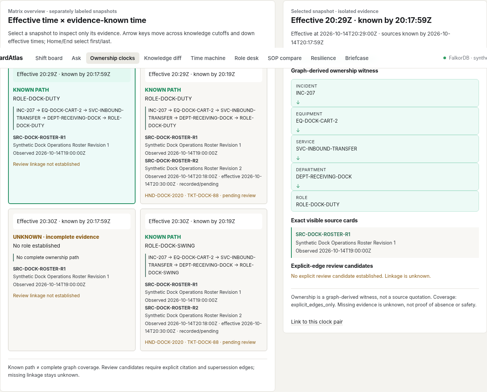
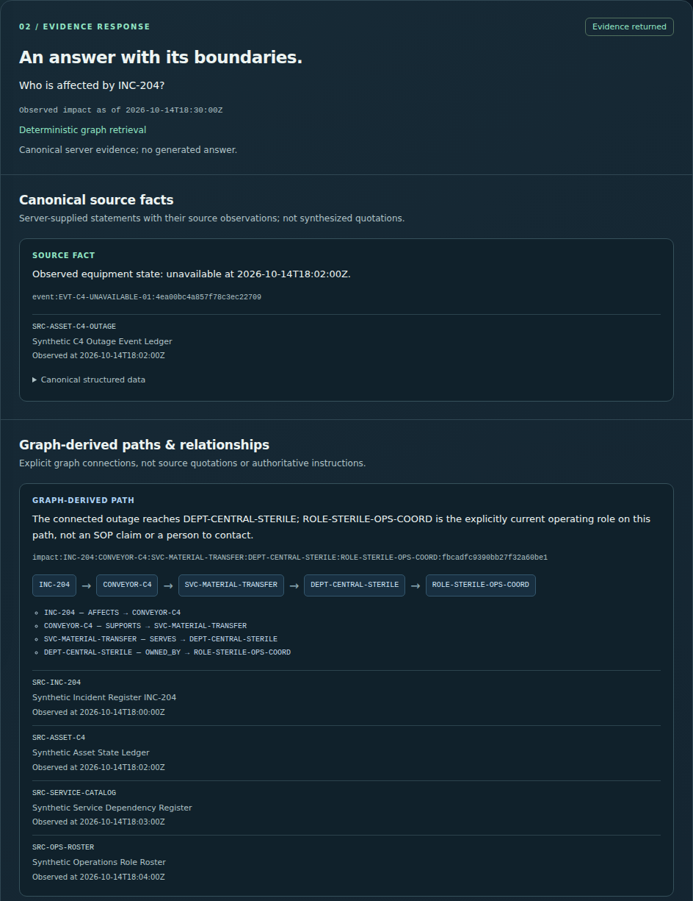
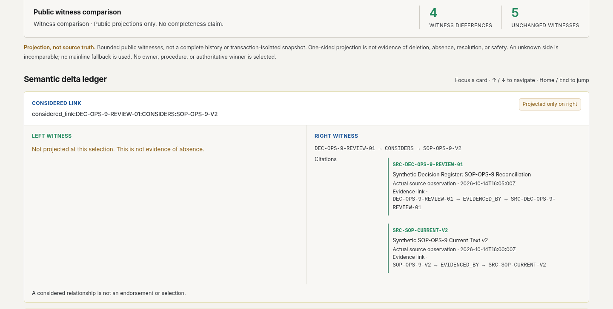
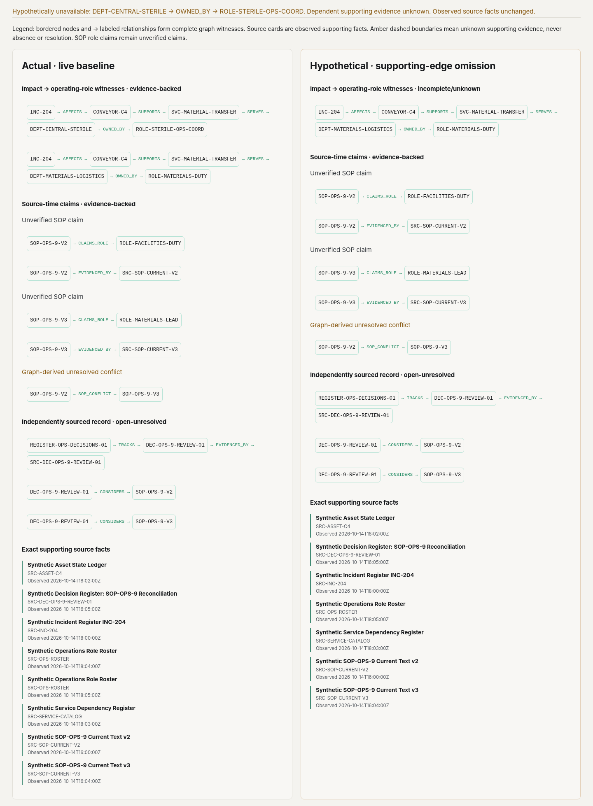
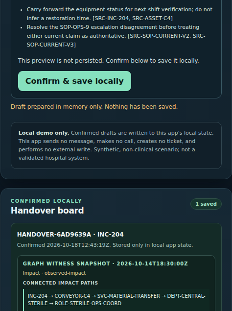
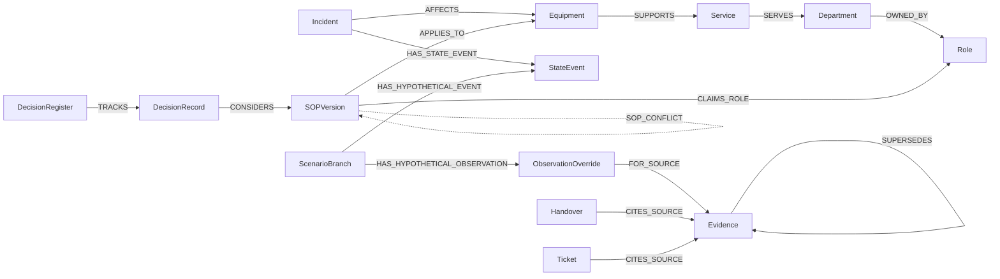

# WardAtlas

WardAtlas connects hospital incidents, SOPs and shift ownership in FalkorDB so operations teams can trace an outage to the departments and roles affected — a **Company Brain** built for hospital operations.



## What you can do

<table>
<tr>
<td width="50%" valign="top"><br><b>Contradictory SOPs stay visible.</b> Versions 2 and 3 name different responsible roles; WardAtlas shows both with their sources and never picks a winner. The archived V1 still points at the old conveyor.</td>
<td width="50%" valign="top"><br><b>Two clocks for every handoff.</b> When a roster change takes effect is kept apart from when anyone knew about it, so a replay never applies knowledge early.</td>
</tr>
<tr>
<td valign="top"><br><b>Ownership clock atlas.</b> The same dock incident at four effective-time × knowledge-time cells. A gap stays unknown instead of being filled from later evidence.</td>
<td valign="top"><br><b>Ask, get a cited answer.</b> The answer is a graph path plus dated source records, retrieved deterministically. <a href="docs/media/ask-citations.png">Full answer</a>.</td>
</tr>
<tr>
<td valign="top"><br><b>Why did the answer change?</b> Compare two knowledge snapshots, recorded or clearly labelled hypothetical, as typed changes.</td>
<td valign="top"><br><b>Pull one edge, see what breaks.</b> Hypothetically remove one supporting relationship: the conclusion that depended on it becomes unknown, not silently wrong.</td>
</tr>
<tr>
<td valign="top"><br><b>Human-confirmed handover.</b> Preview the exact evidence snapshot, explicitly confirm, and it is saved locally. Nothing is sent anywhere. <a href="docs/media/handover.png">Full handover</a>.</td>
<td valign="top"><b>Also in the app</b><ul><li><b>Evidence time machine:</b> play relationships arriving minute by minute.</li><li><b>Role desk:</b> each role's source-backed responsibilities.</li><li><b>SOP claim comparison:</b> any two versions, side by side.</li><li><b>Evidence briefcase:</b> download the displayed evidence as an offline ZIP.</li><li><b>Evidence watch:</b> save an ownership baseline; a refresh reports whether its evidence changed.</li></ul>Every view is a live FalkorDB read over one synthetic hospital graph.</td>
</tr>
</table>

## Why a graph

This actual query follows **incident → equipment → service → department → operating role**, returning the sources behind the path, not just matching words. Copied verbatim from [`CONVEYOR_PATH_QUERY`](scripts/wardatlas_shift_board.py); [query walkthrough](docs/falkordb-query-walkthrough.md).

```cypher
MATCH (i:Incident {id: 'INC-204'})-[aff:AFFECTS]->(e:Equipment {id: 'CONVEYOR-C4'})
      -[sup:SUPPORTS]->(s:Service {id: 'SVC-MATERIAL-TRANSFER'})
      -[serves:SERVES]->(d:Department)-[owns:OWNED_BY]->(r:Role),
      (r)-[roster:EVIDENCED_BY]->(rsrc:Evidence),
      (i)-[iev:EVIDENCED_BY]->(isrc:Evidence),
      (e)-[eev:EVIDENCED_BY]->(esrc:Evidence),
      (s)-[sev:EVIDENCED_BY]->(ssrc:Evidence)
WHERE owns.current = true
  AND i.access = 'operations' AND e.access = 'operations' AND s.access = 'operations'
  AND d.access = 'operations' AND r.access = 'operations'
  AND aff.access = 'operations' AND sup.access = 'operations' AND serves.access = 'operations'
  AND owns.access = 'operations' AND roster.access = 'operations' AND rsrc.access = 'operations'
  AND owns.source_id = rsrc.id
  AND iev.access = 'operations' AND eev.access = 'operations'
  AND sev.access = 'operations' AND isrc.access = 'operations' AND esrc.access = 'operations'
  AND ssrc.access = 'operations'
RETURN i.id AS incident_id, e.id AS equipment_id, s.id AS service_id,
       d.id AS department_id, r.id AS role_id,
       isrc.id AS incident_source_id, isrc.title AS incident_source_title,
       isrc.observed_at AS incident_observed_at,
       esrc.id AS equipment_source_id, esrc.title AS equipment_source_title,
       esrc.observed_at AS equipment_observed_at,
       ssrc.id AS service_source_id, ssrc.title AS service_source_title,
       ssrc.observed_at AS service_observed_at,
       rsrc.id AS ownership_source_id, rsrc.title AS ownership_source_title,
       owns.observed_at AS ownership_observed_at
ORDER BY d.id
```

## Graph data model

Fourteen node labels and eighteen relationship types, read from the seeded graph:



| Idea | How the graph holds it |
| --- | --- |
| Every fact has a source | Incident, Equipment, Service, Role, SOPVersion, StateEvent and DecisionRecord each have `EVIDENCED_BY → Evidence {id, title, observed_at}`; answers return those source IDs. |
| Two clocks | `OWNED_BY {effective_from, effective_to}` says when an assignment holds; `Evidence.observed_at <= known_at` says whether it was known yet. Queries take both times explicitly. |
| Conflicts stay open | `SOP_CONFLICT` links competing SOP versions; a `DecisionRecord` `CONSIDERS` both and the app never picks a winner. |
| What-ifs never overwrite facts | A `ScenarioBranch` adds hypothetical `StateEvent`s or an `ObservationOverride` beside the source facts, which stay unchanged. |
| Access on every hop | Every node and relationship carries `access`; each query filters it on every hop, so restricted evidence cannot leak into a path. |

## Quickstart

With your own **FalkorDB 6.x+ server** already running (setup options below):

```sh
git clone https://github.com/edwardEsmerson/ward-atlas.git
cd ward-atlas
python3 scripts/wardatlas_attach.py --db-host 127.0.0.1 --db-port 6379
```

Open the printed loopback URL; **Reset synthetic scenario** restores the demo. Ctrl-C cleans up only this run's graph and local state. [Judge guide](docs/judge-guide.md) · [Regenerate screenshots](docs/readme-media.md).

**AI & limits:** AI coding agents generated substantial code, fixtures, tests and documentation. The core graph workflow is deterministic. All data is synthetic and non-clinical; this is not a validated hospital system or medical device.

---

# Technical details

## Start with your FalkorDB server

Requires **Python 3.10+ and an existing FalkorDB 6.x+ server**, reachable without authentication. No Python packages, model API or Docker are required by the app. From this repository:

```sh
python3 scripts/wardatlas_attach.py --db-host 127.0.0.1 --db-port 6379
```

Open the printed `WARDATLAS_READY http://127.0.0.1:…` URL. The app uses a free ephemeral loopback port; optionally pass an explicit `--app-port`. It seeds a **new, run-unique synthetic graph and local action state**, never an existing graph. **Ctrl-C** closes the app and removes only that run's graph/state; the supplied database and other graphs remain running and untouched. Saved demo actions are intentionally temporary. The launcher never starts, stops, resets, upgrades or configures your database. Do not supply a production hospital server or credentials.

If you need a server, judges can run their own official image in a separate terminal (not run by WardAtlas):

```sh
docker run --rm -p 127.0.0.1:6379:6379 falkordb/falkordb:6.0.2
```

See the [judge guide](docs/judge-guide.md) for the demo route, existing-server checks and the documented project-local Linux alternative. The older independent check commands below remain available unchanged.

### Why a graph, not a chat wrapper?

`Incident → Equipment → Service → Department → current Role` is an explicit multi-hop ownership/impact path. `EVIDENCED_BY → Evidence` carries source IDs and observation times; SOP version/applicability/conflict edges keep competing claims separate. Effective-time and knowledge-time views expose why an answer changed, and scenario overlays label assumptions rather than rewriting source truth. Python's loopback HTTP app queries actual FalkorDB over RESP and projects deterministic, source-linked results into the responsive UI; human confirmation is required before local action storage. See the [actual Cypher, schema and architecture walkthrough](docs/falkordb-query-walkthrough.md#1-outage--service--department--current-role).

**Limits & AI disclosure:** all people, departments, incidents and sources are fictional. No patient data, diagnosis, treatment, autonomous clinical triage, real-hospital validation or compliance certification. AI agents generated substantial code, fixtures, tests and documentation; the core graph workflow is deterministic. Optional model-assisted layout on Ask WardAtlas is described below and is **not claimed live-model verified**.

## Play the evidence time machine

Open **Evidence time machine** from the control room (`/time-machine`). Play, pause, step or scrub four mainline knowledge frames and explicitly switch to two hypothetical frames. This is a live typed relationship graph, not a cached animation: every selected frame reuses the accepted FalkorDB timeline/branch services. An early frame reveals no future source or decision-record identity. Inspect any node/link with keyboard arrows or the evidence detail list. Solid unverified-claim edges and dashed graph-derived links have textual labels; mobile stacks the graph and details, with reduced-motion support.

`GET /api/replay-frame?frame=3&mode=mainline&scope=operations` returns only that frame. Mainline indices **0–3** select **15:59:59, 16:00, 16:04, 16:05 UTC on 2026-10-14**; hypothetical indices **4–5** select **16:05, 16:06 UTC**. Frame and mode are required exactly once; optional scope is operations-only. The hypothetical V3 observation remains actually **16:04**, with a separately labeled **16:06 assumption**, never a source correction or resolved conflict. Missing branch support is generic unknown without fallback. Offline graph access is unavailable, never canned facts. Playback reset changes no scenario, action or watch data.

```sh
python3 scripts/verify_evidence_replay.py --all --require-live-falkordb --desktop-mobile --assert-keyboard --assert-reduced-motion --fail-on-zero
python3 -m unittest tests.test_evidence_replay
```

These checks passed in the builder and a fresh source-only clone: **12 groups / 85 mapped live assertions**, **18 focused tests**, real FalkorDB, cold/reseed/reconnect, owned mutations, ACL/decoy invariance, keyboard/reduced-motion desktop/mobile, abort-ignoring response races and cleanup. The live check bootstraps the existing digest-pinned module locally, selects free lane/ephemeral ports (or accepts `--db-port` / `--app-port`), and overwrites only its own reports/screenshots under `$WORKSHOP_RUN_DIR/evidence-replay/`. No new queries, fixtures, writes or model route. Supervisor integration acceptance remains separate from builder evidence.

## Product workflow

**Evidence resilience:** `/resilience`, linked from Shift control, compares live witnesses with one hypothetical missing supporting edge. Only baseline, ownership-support omission, and V3 source-evidence omission are available, at October 14, 18:30Z impact time and 16:05Z source time. Each pane has relationship diagrams and exact source cards. Reset re-reads baseline without changing graph, handover, or watch state. Unknown support never means a vanished role, resolved conflict, selected SOP, or safety. This is a read-only experiment, not an outage cascade or risk score.

```sh
python3 -m unittest tests.test_resilience
python3 scripts/verify_resilience.py --all --require-live-falkordb --desktop-mobile --fail-on-zero
```

This check bootstraps the existing digest-pinned local FalkorDB module, selects two free allocated-lane ports (ephemeral outside the workshop), and cleans its unique graph/process/state. Reports and screenshots overwrite only their own outputs under `$WORKSHOP_RUN_DIR/resilience` (default `.local/resilience-evidence/resilience`). Eight frozen groups map 55 assertions; original oracle hashes are verified first. Builder evidence does not replace fresh independent/integration verification.

WardAtlas is a local synthetic hospital-operations control room for the Company Brain track. It uses actual FalkorDB queries to trace a fictional equipment outage through a service to impacted departments and explicitly current operating roles, preserve source provenance, reveal a stale SOP reference and unresolved conflict, and exclude inaccessible evidence. Its integrated shift board keeps the INC-207 dock roster revision separate from INC-204 conveyor event replay: effective-dated ownership, explicit-edge review candidates, observed restoration, and a forked hypothetical drill are inspectable at pinned times. The responsive UI separates source facts, graph inference and missing evidence. A handover preview carries an inspectable, timestamped snapshot of the exact impact paths and explicit source-backed SOP witness from the existing read-only graph query; missing edges stay incomplete/unknown. The confirmed local action stores that same snapshot only after an explicit confirmation click. It does not send messages, make calls, create tickets, or perform external writes. Fixtures are invented and non-clinical; WardAtlas is not a validated hospital system or medical device.

For the short operator-focused demo path, see the [demo runbook](docs/demo-runbook.md).

## Explain why two graph answers differ

Open **Knowledge diff** on the control room (`/knowledge-diff`, accessible name “Explain answer differences”). Independently choose each snapshot's knowledge cutoff and `mainline` or `hypothetical` mode. The workspace compares five types of live public graph witnesses: unverified claims, source observations, graph-derived conflict, the separately evidenced decision record, and explicit `CONSIDERS` links. Citations retain exact IDs, titles and observation times. V3's actual observation stays **16:04Z**; its branch assumption is separately labeled **16:06Z**, never applied to V2.

`GET /api/knowledge-diff?left_known_at=2026-10-14T16:04:00Z&right_known_at=2026-10-14T16:05:00Z&left_mode=mainline&right_mode=mainline` explains the record-source boundary without inventing an SOP change. All four parameters are required exactly once; explicit offsets normalize to UTC. A one-sided witness is **projected only on left/right**, not deleted, resolved or safe. Partial knowledge is labeled; a missing branch witness makes that side **comparison-unavailable**, with incomparable items and no mainline fallback. This is a bounded comparison, not a completeness claim. It reuses the accepted timeline/branch services under their reentrant application lock, **not database transaction isolation**. No saved action, graph write, source correction, model or clinical inference is involved.

```sh
python3 -m unittest tests.test_knowledge_diff
python3 scripts/verify_knowledge_diff.py --all --require-live-falkordb --desktop-mobile --fail-on-zero
```

The product-only verifier uses the two in-repository, hash-pinned source oracles and pre-implementation `contracts/knowledge-diff/` artifacts (10 groups / 63 mapped assertions). It bootstraps the existing digest-pinned FalkorDB locally, selects free loopback ports, owns unique graph/state/processes, captures API/desktop/mobile/keyboard evidence, and cleans only its own resources. Reports default to `$WORKSHOP_RUN_DIR`; no external planner checkout is needed. Setup prerequisites are below. Builder evidence is distinct from supervisor acceptance and human submission eligibility.

## Ask WardAtlas

Open **Ask WardAtlas** from the control room, or visit `/ask` on the same local app. Select the requested synthetic INC-204 operations context, ask one supported question, and supply one explicit time:

- “Who is affected by INC-204?” — impact `as_of` **2026-10-14T18:30:00Z**; compare **19:30Z** restoration without inferring safety.
- “Explain the SOP-OPS-9 disagreement” — evidence `known_at` **2026-10-14T16:05:00Z**; neither claim becomes an owner or procedure.
- “What was known about the decision?” — compare **15:59:59Z**, **16:04Z**, and **16:05Z**. The record appears only at its own source boundary.

`POST /api/questions` accepts JSON fields `scope: "operations"`, `context: "inc204-operations"`, `question`, one of `as_of`/`known_at`, and optional boolean `compose`. Bounded wording is intentional: ambiguous, unsupported, or unestablished identifiers ask for clarification. Retrieval reuses the live FalkorDB `sop_impact` and `decision_timeline` services, never the current briefing for a past cutoff. Canonical source facts, graph paths, missing evidence, and exact source ID/title/observation tuples are inspectable separately. This endpoint creates no actions or watches.

Optional **model-assisted layout** reads server-only `WARDATLAS_LLM_BASE_URL` (default `WORKSHOP_LLM_BASE_URL`), `WARDATLAS_LLM_API_KEY`, and `WARDATLAS_LLM_MODEL`. Only a configured numeric-loopback HTTP proxy and pinned `gpt-6.1-sol` model are permitted; the proxy may use a nonempty `proxy` placeholder instead of a key. Nothing is sent by default. No browser keys or provider fallback are used. The model can only permute all canonical fact IDs and select one of two layouts; prose, false assertions even with valid citations, tools, extra fields, unavailable/malformed responses, or timeout return the **identical deterministic graph answer**. A live model is not required or claimed verified.

```sh
python3 scripts/verify_questions.py --all --stub-model --require-live-falkordb --desktop-mobile --fail-on-zero
python3 -m unittest tests.test_questions
```

The verifier bootstraps the digest-pinned FalkorDB module below from a source-only checkout, chooses free allocated/ephemeral loopback ports, exercises 11 frozen groups / 78 mapped assertions plus graph mutations and local model adversaries, captures keyboard/desktop/mobile evidence under `$WORKSHOP_RUN_DIR/questions/`, and stops/removes only its owned resources. Expectations were committed before behavior in `8877158`; both accepted source-oracle hashes are checked unchanged.

## Clean setup and verification

Requirements: Python 3.10+, an existing `redis-server` executable, Node.js and the workshop's local Playwright browser for browser acceptance, and outbound access to the public Docker Hub OCI registry on the first run from a source-only checkout. No Docker daemon/socket, Python package install, account, credentials, `sudo`, or host service change is used. The database binary and provenance receipt are installed under ignored `.local/` only.

The live verifier automatically bootstraps the pinned official `falkordb/falkordb:6.0.2` Linux/amd64 module when `.local/falkordb/` is absent, verifies the OCI index/manifest/layer digests and fixed module SHA-256, and validates the resulting provenance receipt before launch. It uses at most three network attempts with short backoff for transient registry failures; download or provenance errors fail the check truthfully without starting a database or falling back to a fake. A present but altered module/receipt fails closed. `python3 scripts/install_falkordb_module.py` remains available for explicit prefetching but is not required to warm a fresh checkout.

Choose both ports from the current worker's allocated private range; never probe or reuse an occupied listener. For example, the assigned `WORKSHOP_PORT_BASE` is the app port and the next port is the database port:

```sh
: "${WORKSHOP_PORT_BASE:?set the allocated private port base}"
: "${WORKSHOP_PORT_SPAN:?set the allocated private port span}"
APP_PORT="$WORKSHOP_PORT_BASE"
DB_PORT="$((WORKSHOP_PORT_BASE + 1))"
test "$((DB_PORT - WORKSHOP_PORT_BASE))" -lt "$WORKSHOP_PORT_SPAN"
```

Run the independent expected-results checks and then the live integration suite directly from a fresh source-only checkout:

```sh
python3 scripts/verify_expected_results.py --expected tests/expected-results.json --matrix tests/adversarial-matrix.json --require-six-scenarios
python3 scripts/verify_falkordb_live.py --require-live --fail-on-zero --fresh-owned-graph --db-port "$DB_PORT" --empty-reseed-idempotence-reconnect --report /workspace/evidence/wardatlas/falkordb-scenarios.json --verify-morning-status
```

The live verifier starts its own `redis-server` with the verified module, binds only to `127.0.0.1:$DB_PORT`, and uses a fresh unique graph. If that address cannot be bound, it stops without connecting to the occupant. It deletes only its owned graph and stops its own process. The JSON report contains runtime module provenance/version, scenario assertions, read-only CPU/memory facts, owned-process RSS samples and individual command timings. The report is evidence for that single run, not a generalized benchmark.

Run the complete desktop/mobile app workflow check (it starts its own real FalkorDB and loopback UI, tests the live API and browser, saves evidence, then stops both owned processes):

```sh
python3 scripts/verify_hospital_workflow.py --launch-owned-app --loopback-only --app-port "$APP_PORT" --require-live-falkordb --db-port "$DB_PORT" --fail-on-zero --assert-api --assert-browser --assert-provenance --assert-permissions --assert-confirmation --browser-smoke-tool /tools/browser-smoke.py --desktop-mobile --verify-morning-status-and-feature-matrix --evidence-dir /workspace/evidence/wardatlas/ui
```

The latest exact results and the honest implemented/verified/planned feature matrix are in [`MORNING-STATUS.md`](MORNING-STATUS.md) and [`FEATURE-MATRIX.md`](FEATURE-MATRIX.md). `scripts/wardatlas_app.py` is the local app entrypoint when an explicitly selected, empty, unique FalkorDB graph is already running (use a name such as `wardatlas_ui_<unique-id>`); it refuses to reset nonempty data it did not seed. The workflow verifier above is the reproducible, isolated demo/evidence path.

## Pinned behavior

`tests/expected-results.json` is the original eight-outcome oracle for the current outage flow. The independent shift-board oracle is `tests/shift-board-expected-results.json`; `tests/shift-board-adversarial-matrix.json` maps all eight integrated outcomes to nonzero checks. Run `python3 scripts/verify_shift_board_contract.py` with the four pinned planner packet paths (see the operator-approved command) to verify the immutable JSON/matrix mapping without consulting candidate behavior. The live UI verifier applies that oracle to actual FalkorDB results, including cold empty, INC-207's 20:29/20:30 ownership boundary and explicit-edge queue, INC-204's 18:30/19:30 replay and 18:50 branch, cross-case isolation, restricted-source invariance, local confirmation, idempotent reseed/reconnect, and owned cleanup. Its browser run includes the cold/empty view and responsive board. All entities and sources are synthetic. No patient data, clinical advice, real hospital integration, or external writes are included.

## Graph-backed SOP conflict impact trace

The additive `/api/sop-impact?scope=operations&as_of=...` view joins the INC-204 → CONVEYOR-C4 → material-transfer service paths to SOP-OPS-9 only through explicit `APPLIES_TO`, `SOP_CONFLICT`, and `CLAIMS_ROLE` relationships plus source-evidence edges. Its claim rows are always labeled **unverified SOP claim**, separately from roster-derived current-owner paths. Removing either pinned applicability or conflict edge removes the complete witness but does not infer that the SOP is resolved or that no conflict exists. The archived V1/C3 source remains visible as history and is not attached to the C4 witness. Offset timestamps normalize to UTC; an observed restoration removes active impact paths without resolving the independent SOP disagreement. This is read-only, synthetic, operations-scoped and non-clinical.

## Confirmed handover graph-witness snapshot

`POST /api/handover/draft` accepts an optional explicit ISO-8601 `as_of` value (default `2026-10-14T18:30:00Z`) and calls the already-accepted `/api/sop-impact` service. `scripts/wardatlas_handover.py` is a pure projection; it does not duplicate graph traversal. The returned `snapshot` holds normalized `as_of`, ordered impact paths with each source ID/title/observation time, and a typed SOP witness with the real applicability/conflict edges, claim labels, provenance and archived-V1 exclusion. The preview does not write graph or action state. A removed witness edge preserves the outage paths, changes only witness linkage to `incomplete/unknown` or `unknown`, and removes the incident-linked SOP review proposal. Confirmation stores an immutable copy of the snapshot in the one local synthetic action; later graph changes do not rewrite what was reviewed. A missing edge is never reported as “resolved” or “no conflict.”

## Register-rooted decision provenance docket

The read-only `GET /api/decision-docket?scope=operations` traverses the synthetic `DecisionRegister -[:TRACKS]-> DecisionRecord` root and requires the record's own `EVIDENCED_BY` edge before exposing its ID, title, state, or register source. It then follows `CONSIDERS`, `CLAIMS_ROLE`, and claim-source `EVIDENCED_BY` relationships to show both SOP-OPS-9 role claims and their source titles/timestamps beside the unresolved V2→V3 conflict. This record says **open-unresolved**; it does not select an SOP winner, current owner, procedure, contact, or action. Missing evidence yields generic unknown or incomplete/unknown, never an absence or resolution conclusion. Every traversed node and edge is operations-filtered; a connected restricted-source injection leaves the complete API and accessible browser view unchanged. The app's synthetic reset seeds this additive fixture idempotently into its actual FalkorDB graph.

Run the focused tests and actual-FalkorDB/API/browser verifier (the latter chooses distinct ports from this worker's `WORKSHOP_PORT_BASE`/`WORKSHOP_PORT_SPAN` and cleans only its lane-named graph/process/state):

```sh
python3 -m unittest tests.test_decision_provenance_docket tests.test_decision_provenance_contract
python3 scripts/verify_decision_provenance_live.py --require-live-falkordb --require-nine-groups --assert-api --assert-browser --desktop-mobile --assert-owned-cleanup
```

The live check exercises all nine frozen packet groups and their 54 mapped assertions, including the three exact edge counterfactuals, idempotent restoration, fresh-client reads, restricted-view invariance, and desktop/mobile browser evidence. It is synthetic behavior evidence only, not real-hospital validation.

## Source-observation-time decision replay

The additive read-only `GET /api/decision-timeline?scope=operations&known_at=2026-10-14T16:04:00Z` reconstructs what the operations graph could support at an explicit UTC cutoff. Claims are queried only through the accepted SOP-impact path (`INC-204 → CONVEYOR-C4 → SOPVersion -[:APPLIES_TO]-> C4`, then source-linked `CLAIMS_ROLE` and `EVIDENCED_BY` edges), with each source's `observed_at` filtered in FalkorDB before projection. The graph-derived `SOP_CONFLICT` edge appears only when both independently evidenced claims are visible; it is not a source quotation or authoritative procedure.

Decision state has a separate register-rooted query (`DecisionRegister -[:TRACKS]-> DecisionRecord -[:EVIDENCED_BY]-> Evidence`). Before that record's own source cutoff the result contains no record/`CONSIDERS` details or existence claim, and the record path never discovers pre-boundary claims. After the boundary, a `CONSIDERS` edge is returned only when its target is also present in the independently source-known SOP-impact claims. A moved V3 observation time or removed evidence edge therefore suppresses V3-dependent output without erasing the record's separately evidenced `open-unresolved` state or promoting V2. Unknown/incomplete means only that the requested cutoff lacks sufficient source evidence; it does not mean absent, resolved, safe, or current.

The cutoff accepts explicit ISO-8601 offsets and normalizes to UTC; malformed or timezone-naive inputs reject before graph/action state changes. Omitting `known_at` returns a generic unknown projection (no local-clock fallback). The responsive replay controls default to the record boundary for a useful initial view; selecting an earlier/incomplete cutoff clears the separate docket card while retaining the read-only `/api/decision-docket` endpoint. The feature adds no fixture facts, writes, ingestion, model route, contact, or clinical inference.

Run the unit checks and the actual-FalkorDB/API/desktop-mobile browser verification (ports are selected from this lane's private `WORKSHOP_PORT_BASE` range; every graph/state/process is task-owned):

```sh
python3 -m unittest tests.test_decision_knowledge_timeline tests.test_decision_knowledge_timeline_contract
python3 scripts/verify_decision_knowledge_timeline_live.py --require-live-falkordb --all-twelve-groups --assert-api --desktop-mobile --assert-no-future-leak --assert-reconnect --assert-owned-cleanup
```

The frozen candidate-independent oracle maps 12 groups to 120 assertions. The live run covers cold/empty and all source boundaries, V3 timestamp shift (including a desktop/mobile browser replay at 16:05), both evidence-edge removals, decoy/restricted invariance, offset/rejection behavior, reseed, fresh-client reads, read-only API/browser output, and owned cleanup. Builder evidence: `/workspace/evidence/decision-knowledge-timeline/lane-2/live-d126ea36313045ca97c526dfee0b0879.json` with screenshots and browser reports beside it. This is implementation evidence; an independent clean-source reverify remains a separate gate.

## Hypothetical source-observation branch

The additive read-only `GET /api/decision-source-branch?scope=operations&known_at=2026-10-14T16:05:00Z` returns the unchanged source-time `/api/decision-timeline` projection beside a graph-stored hypothetical projection. The branch is discovered only through `ScenarioBranch -[:HAS_HYPOTHETICAL_OBSERVATION]-> ObservationOverride -[:FOR_SOURCE]-> Evidence`; FalkorDB applies the override's assumed observation time to V3 before projecting its evidence-backed claims. The original Evidence fact stays observed at **16:04Z**. At the shared 16:05Z cutoff V3 and its dependent conflict are absent from the hypothetical pane while V2 and the separately sourced `open-unresolved` record remain; at 16:06Z V3 returns only as a labeled hypothetical. Mainline remains unchanged at both times.

If either branch edge is missing, the hypothetical projection is generic `incomplete/unknown`: it does not reuse mainline claims, disclose branch/source identities, or infer absence or resolution. Queries filter every path node and edge to `operations`; disconnected decoys and connected restricted-source injections leave the complete visible projection unchanged. A native keyboard-selectable cutoff drives both accessible desktop panes and the stacked mobile view from the same API response. The endpoint does not write the graph or action state.

Run the frozen source packet check (including its content-bound reviewer receipt), focused mutation tests, and actual-FalkorDB/API/browser verification from the allocated lane range:

```sh
python3 scripts/verify_decision_source_branch_contract.py --expected contracts/decision-source-branch/expected-results.json --matrix contracts/decision-source-branch/adversarial-matrix.json --pinned-plan /workspace/worktrees/planner-4889c5b5d5d542cb9a7d33b48d7ca1b0/plans/planner-4889c5b5d5d542cb9a7d33b48d7ca1b0.md --require-eight-groups --check-frozen-oracle-hashes --require-review-receipt
python3 -m unittest tests.test_decision_source_branch tests.test_decision_source_branch_contract
python3 scripts/verify_decision_source_branch_live.py --require-live-falkordb --all-eight-groups --assert-api --desktop-mobile --assert-keyboard --assert-mainline-immutable --assert-no-fallback --assert-reconnect --assert-owned-cleanup
```

The live check selects FalkorDB/app ports at `WORKSHOP_PORT_BASE+90/+91`, uses an empty run-unique graph, exercises all eight groups and 74 pinned assertions, then removes only its graph, database/app processes, runtime directory, and local state. It captures cold/seeded, missing-edge, ACL-invariance, reconnect, desktop, keyboard, and mobile evidence. The pinned planner path is workshop evidence and must be supplied for clean-source contract validation; the submitted JSON and manifest carry the frozen expectations and exact source hashes. This remains synthetic operations replay, not source truth or hospital validation.

Check the candidate-independent nine-case packet, unit tests, actual FalkorDB/API behavior, and desktop/mobile browser from this worker's allocated ports:

```sh
: "${WORKSHOP_PORT_BASE:?set the allocated private port base}"
: "${WORKSHOP_PORT_SPAN:?set the allocated private port span}"
: "${WORKSHOP_LANE:?set the allocated workshop lane}"
DB_PORT="$((WORKSHOP_PORT_BASE + 80))"
APP_PORT="$((WORKSHOP_PORT_BASE + 81))"
test "$((APP_PORT - WORKSHOP_PORT_BASE))" -lt "$WORKSHOP_PORT_SPAN"
python3 scripts/verify_handover_brief_contract.py --expected tests/handover-brief-expected-results.json --matrix tests/handover-brief-adversarial-matrix.json --pinned-plan /workspace/worktrees/planner-d0017f7f160844fe9cf5a6036aa5068f/plans/planner-d0017f7f160844fe9cf5a6036aa5068f.md --require-nine-cases
python3 -m unittest tests.test_handover_brief_contract tests.test_handover_snapshot tests.test_handover_live_cleanup
python3 scripts/verify_handover_brief_live.py --db-port "$DB_PORT" --app-port "$APP_PORT" --report "/workspace/evidence/preserve-handover-graph-witness/$WORKSHOP_LANE/live.json" --evidence-dir "/workspace/evidence/preserve-handover-graph-witness/$WORKSHOP_LANE/browser"
```

The live verifier owns a unique lane-named graph, loopback app, project-local state directory and database process; it deletes only those resources. On a source-only checkout the pinned FalkorDB module is bootstrapped and digest-verified automatically.

## Confirmed handover drift review

The read-only `GET /api/handover/compare?scope=operations&action_id=...&observed_at=...&branch_at=...` endpoint compares a confirmed action's immutable `snapshot` with fresh results from the existing FalkorDB-backed SOP-impact and shift-board queries. The defaults are the pinned `2026-10-14T19:30:00Z` observed restoration and `2026-10-14T18:50:00Z` hypothetical drill. Added/removed path records carry their complete source IDs, titles and observation times; the unresolved SOP witness is a separate object. Missing current graph state or witness links remain unknown, never resolution or safety. The browser comparison appears on each saved action and labels the branch hypothetical beside the still-observed mainline. It does not create a draft, confirm an action, mutate the graph, or rewrite the saved action.

Run the frozen nine-case oracle, focused drift tests, and the actual-FalkorDB/API/desktop-mobile workflow with all accepted regression suites from a clean source checkout:

```sh
: "${WORKSHOP_PORT_BASE:?set the allocated private port base}"
: "${WORKSHOP_PORT_SPAN:?set the allocated private port span}"
: "${WORKSHOP_LANE:?set the allocated workshop lane}"
python3 scripts/verify_handover_drift_contract.py --expected tests/handover-drift-expected-results.json --matrix tests/handover-drift-adversarial-matrix.json --pinned-plan /workspace/worktrees/planner-828ef7b6a76e4128b9e1b2ecad33c4a7/plans/planner-828ef7b6a76e4128b9e1b2ecad33c4a7.md --require-nine-cases
python3 -m unittest discover -s tests -p 'test_handover_drift*.py'
python3 scripts/verify_handover_drift_workflow.py --require-live-falkordb --fail-on-zero --fresh-owned-graph --private-range-from-env --assert-api --assert-browser --assert-path-delta --assert-witness-provenance --assert-immutable-action --assert-acl --desktop-mobile --verify-all-accepted-suites --assert-owned-cleanup
```

The drift verifier selects distinct ports from the worker's allocated range, names its graph with the lane and a unique run ID, starts only loopback processes, bootstraps the pinned FalkorDB module when needed, and deletes only its graph/data/state and stops only its app/database processes. Its report and responsive screenshots are stored under `/workspace/evidence/handover-drift/$WORKSHOP_LANE/`. `--verify-all-accepted-suites` runs the pinned original, shift-board, SOP-impact, handover-witness, drift, cascade, role-scope, review-receipt, dock-bitemporal, escalation, and source-change contracts, all unit tests, the dock-bitemporal live API/browser workflow, and the integrated UI/API/browser regressions. A green result is synthetic behavior evidence, not real-hospital validation.

Exercise all ten pinned groups against actual FalkorDB and the live API/browser from a clean source checkout (the verifier bootstraps the existing digest-pinned local module when needed):

```sh
: "${WORKSHOP_PORT_BASE:?set the allocated private port base}"
: "${WORKSHOP_PORT_SPAN:?set the allocated private port span}"
DB_PORT="$((WORKSHOP_PORT_BASE + 20))"
APP_PORT="$((WORKSHOP_PORT_BASE + 21))"
test "$((APP_PORT - WORKSHOP_PORT_BASE))" -lt "$WORKSHOP_PORT_SPAN"
python3 scripts/verify_sop_impact_contract.py --expected tests/sop-impact-expected-results.json --matrix tests/sop-impact-adversarial-matrix.json --pinned-plan /workspace/worktrees/planner-3bfcb0d8abbc45bc82e0fab8d715c2da/plans/planner-3bfcb0d8abbc45bc82e0fab8d715c2da.md --require-ten-cases
python3 -m unittest tests.test_sop_impact_contract
python3 scripts/verify_sop_impact_live.py --pinned-plan /workspace/worktrees/planner-3bfcb0d8abbc45bc82e0fab8d715c2da/plans/planner-3bfcb0d8abbc45bc82e0fab8d715c2da.md --db-port "$DB_PORT" --app-port "$APP_PORT" --report "/workspace/evidence/sop-conflict-impact-trace/$WORKSHOP_LANE/live.json" --evidence-dir "/workspace/evidence/sop-conflict-impact-trace/$WORKSHOP_LANE/browser"
```

The live check uses a run-unique lane-named graph, binds only loopback, mutates only its named test-owned edges, opens a fresh FalkorDB client, and cleans only its graph, app, state directory and database process. The browser report includes desktop/mobile assertions and screenshots. A build-time live pass is implementation evidence, not independent acceptance; the fresh independent reverify remains a separate gate.

## Shift-board graph walkthrough

- **Dock ownership:** `Incident(INC-207) -[:AFFECTS]-> Equipment -[:SUPPORTS]-> Service -[:SERVES]-> Department -[:OWNED_BY]-> Role -[:EVIDENCED_BY]-> Evidence`. The ownership relationship has a half-open `[effective_from, effective_to)` interval and an explicit source ID. `SRC-DOCK-ROSTER-R2` is observed at 20:18Z, effective at 20:30Z, and points to R1 with `SUPERSEDES`; the 20:29 and 20:30 queries therefore change only the final role node.
- **Review candidates:** `Handover/Ticket -[:CITES_SOURCE]-> R1 <-[:SUPERSEDES]- R2`. The query requires both edges, so `HND-DOCK-2020` and `TKT-DOCK-88` are returned but the lexical-only handover is not. Historical role/source properties remain on the handover; missing links are reported as unknown rather than current.
- **Conveyor replay:** observed `StateEvent` nodes connect from INC-204 through `HAS_STATE_EVENT` and to their `Evidence` via `EVIDENCED_BY`. The API selects the latest source-backed event at or before the requested UTC time; the separate multi-hop impact query returns connected service/department/current-role paths only while that event says unavailable. The `ScenarioBranch(BR-C4-RESTORE-DRILL)` relation points only to its hypothetical 18:45Z event, leaving the observed event history unchanged. Branch reset deletes only that event/branch overlay.
- **Access and side effects:** all traversed nodes, relationships and source records are filtered to `operations`; the restricted fixtures are deliberately connected adversarially but do not change operations results. `/api/shift-board?scope=operations&dock_at=...&conveyor_at=...&branch_at=...` is read-only. Reset and handover confirmation remain separate local endpoints; confirmation writes one synthetic JSON action only after an explicit click.

## Dock ownership: effective time × knowledge time

The dock board keeps the original `/api/shift-board?dock_at=...` projection byte-shape compatible when `known_at` is omitted. For a bitemporal request, use `effective_at` for the ownership interval and `known_at` for source observation and explicit review-edge visibility, for example:

```text
/api/shift-board?scope=operations&effective_at=2026-10-14T20:29:00Z&known_at=2026-10-14T20:17:59Z
```

At the same effective instant, advancing knowledge to 20:19Z reveals R2 provenance and its two explicit review candidates but leaves R1's duty path in place. At effective 20:30Z with only 20:17:59Z knowledge, R1 has expired and R2 is not visible, so ownership is unknown rather than guessed with hindsight. UTC-offset inputs normalize on both axes; malformed or timezone-naive values reject before graph or action-state mutation. The board offers independent controls for both times and labels an observed R2 as pending review, not an invalidated artifact.

Run the pinned artifact and mutation checks, then the actual-FalkorDB/API/browser suite (ports come from this lane's private range):

```sh
python3 scripts/verify_dock_bitemporal_contract.py --expected tests/dock-bitemporal-expected-results.json --matrix tests/dock-bitemporal-adversarial-matrix.json --pinned-plan /workspace/worktrees/planner-280b00074097409f80433898c7dcdac8/plans/planner-280b00074097409f80433898c7dcdac8.md --require-ten-groups --check-frozen-oracle-hashes
python3 -m unittest discover -s tests -p test_dock_bitemporal_contract.py
python3 scripts/verify_dock_bitemporal_live.py --require-live --all-ten-groups --desktop-mobile --assert-permissions --assert-reconnect
```

The live report checks all 60 mapped assertions from the ten fixed groups, cold/empty, edge removal and reseed, denied-source invariance, reconnection, and desktop/mobile API agreement. It starts an owned loopback FalkorDB/app and removes only its own graph/process/state directory. The expected-results and adversarial matrix remain candidate-independent and frozen.

## INC-207 next-shift evidence watch

The watch card previews the R1 ownership witness at `effective_at=20:29Z` and `known_at=20:17:59Z` from the accepted live FalkorDB shift-board query. Preview is read-only. An explicit in-app confirmation saves exactly one local baseline to `evidence-watch.json`, separate from `confirmed-actions.json`; replaying its confirmation token is idempotent. Refresh re-queries both time axes and compares the ordered path and source versions, yielding only `unchanged`, `new-source-known`, `unknown`, or `changed`. R2 remains pending review at 20:29Z when newly known; at the 20:30Z boundary early knowledge remains unknown, while known R2 selects the swing path. Missing edges or source evidence do not become “no owner,” safe, current, or resolved. No graph, handover, ticket, message, call, or external state is written.

Run the candidate-independent nine-group contract, focused projection/mutation tests, and actual-FalkorDB/API/browser workflow:

```sh
python3 scripts/verify_evidence_watch_contract.py --expected tests/evidence-watch-expected-results.json --matrix tests/evidence-watch-adversarial-matrix.json --pinned-plan /workspace/worktrees/planner-3bfe3e5297d44e829f1f958a41c6c772/plans/planner-3bfe3e5297d44e829f1f958a41c6c772.md --require-nine-cases --check-frozen-oracle-hashes --review-receipt tests/evidence-watch-independent-review.json
python3 -m unittest tests.test_evidence_watch tests.test_evidence_watch_contract
python3 scripts/verify_evidence_watch_live.py --require-live-falkordb --all-nine-groups --assert-api --assert-browser --desktop-mobile --assert-acl --assert-confirmation-boundary --assert-reconnect --assert-owned-cleanup
```

The live verifier selects DB/app ports at offsets +40/+41 inside the current `WORKSHOP_PORT_BASE`/`WORKSHOP_PORT_SPAN`, uses a unique lane-named graph and state directory, and deletes only its owned graph, process, runtime directory and watch state. It checks all 86 frozen assertions, edge/source sensitivity, denied-source API and accessible desktop/mobile DOM invariance, explicit browser confirmation, reconnect/reseed and cleanup. This is synthetic operations evidence, not real roster validation or a hospital system.

## Download historical evidence, not an action

Open **Historical evidence briefcase** (`/briefcase`) from Shift control. Choose one outage impact snapshot, SOP source-time mainline, or hypothetical source-time context and its explicitly labeled UTC time. Inspect the read-only preview, then click **Download displayed evidence ZIP**. The local ZIP contains exactly that displayed capture: `evidence.json`, standalone offline `report.html`, and `manifest.json`. Changing selection does not download anything; late responses cannot replace a newer selection. There is no upload, importer, attachment reader, saved export or operational action.

The report separates source facts, graph inference, unknowns, typed relationship witnesses and citation occurrences. The same roster source ID retains its separate 18:04Z/18:05Z observations on the two paths. Hypothetical V3 actual observation (16:04Z) and assumed projection time (16:06Z) remain distinct. Outage impact and SOP knowledge are not combined into a causal briefing. Synthetic historical evidence is **not current truth**; no SOP winner, resolution or safety is inferred. Manifest SHA256 values hash exact file bytes for accidental-change detection only, **not signatures, authenticity or proof of correctness**.

```sh
python3 -m unittest tests.test_evidence_briefcase
python3 scripts/verify_evidence_briefcase.py --all --require-live-falkordb --desktop-mobile --assert-downloaded-bytes --assert-offline --fail-on-zero
```

The product-only check automatically bootstraps the digest-pinned local FalkorDB module described above, selects free allocated-lane/ephemeral ports, and owns a run-unique graph/state/process set. It verifies the three unchanged source-oracle hashes and pre-behavior `contracts/evidence-briefcase/` mappings, exercises cold/reseed/new-client reconnect and witness removals, checks complete restricted-injection package invariance with a frozen capture clock, and proves unchanged graph/action/watch state. Chromium downloads the actual ZIP, verifies its bytes against the displayed package, then opens that same extracted HTML offline on desktop/mobile with networking blocked. Its strict non-extracting verification reader rejects duplicate/traversal/oversize ZIPs and bad hashes; it is not a product importer. Rerunnable reports, ZIPs and screenshots are under `$WORKSHOP_RUN_DIR/briefcase` (default `.local/briefcase-evidence/briefcase`). Builder evidence does not replace independent verification or certify participant eligibility.
